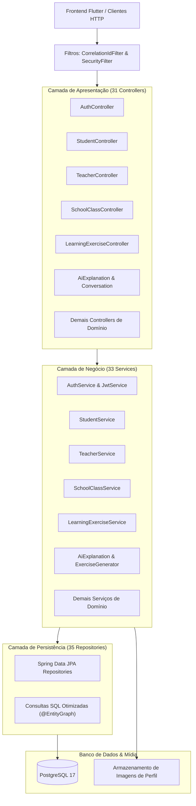
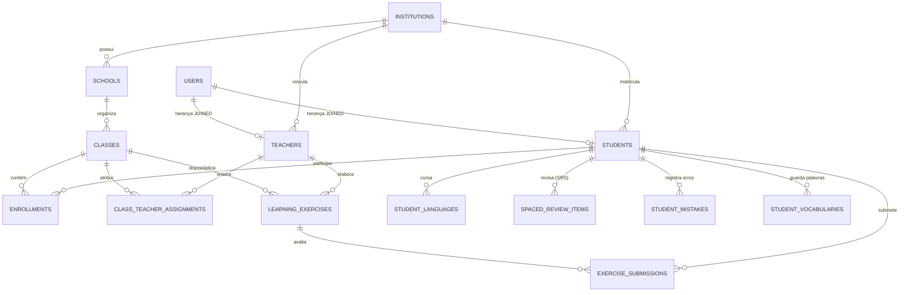

# Duolinfo — Documento de Apresentação e Arquitetura do Projeto

---

## 1. Visão Geral do Projeto

O **Duolinfo** é um ecossistema educacional corporativo e acadêmico para o ensino e aprendizagem de idiomas. A plataforma integra um backend robusto em **Java 17 (LTS)** com **Spring Boot 4.1.1** e um frontend reativo e moderno em **Flutter 3.x (Dart)**.

Diferente de protótipos acadêmicos convencionais, o projeto evoluiu para uma aplicação de nível de produção (*production-ready*), contemplando:
- Autenticação federada com Google Identity Services e autenticação local por e-mail/senha com tokens **JWT (JJWT 0.12.5)** e fluxo de `refreshToken`.
- Gestão completa de papéis e autorizações (`ROLE_STUDENT`, `ROLE_TEACHER`, `ROLE_INSTITUTION_ADMIN`, `ROLE_ADMIN`).
- Inteligência Artificial Generativa integrada ao motor pedagógico (**Google Gemini AI**).
- Sistema de Repetição Espaçada (**SRS**) baseado no algoritmo SuperMemo (SM-2).
- Módulo de prática de pronúncia com avaliação fonética.
- Estúdio do Professor para elaboração, clonagem e distribuição de atividades com auxílio de IA.
- Analítica preditiva de turmas e detecção de risco de evasão acadêmica.
- Revisão comunitária por pares (*peer-review*) com critérios estruturados e moderação.
- Gamificação completa com ofensiva diária (*streak*), compra de congelamentos e missões.
- Observabilidade de ponta a ponta com **Correlation IDs**, **MDC structured logging** e **Spring Boot Actuator**.

---

## 2. Objetivos Principais

1. **Eficiência Pedagógica**: Proporcionar ao estudante uma trilha de aprendizagem adaptativa baseada nos níveis do Quadro Comum Europeu de Referência para Línguas (CEFR A1-C2).
2. **Empoderamento Docente**: Reduzir a carga de trabalho de professores através de assistentes inteligentes para geração de exercícios, distratores e correções imediatas.
3. **Engajamento e Retenção**: Utilizar gamificação, metas diárias, caderno inteligente de erros e repetição espaçada para maximizar a fixação de vocabulário.
4. **Governança Institucional**: Fornecer a coordenadores e administradores métricas confiáveis sobre desempenho de turmas, aprovação de docentes e gestão de instituições de ensino.
5. **Confiabilidade Operacional**: Garantir alta disponibilidade, segurança contra SQL Injection, prevenção de concorrência com locks otimistas e rastreabilidade distribuída de erros.

---

## 3. Stack Tecnológico Atualizado

### Backend (Java / Spring Boot)
- **Linguagem**: Java 17 LTS.
- **Framework**: Spring Boot 4.1.1 (Starter WebMVC, Starter Security, Starter Data JPA, Starter Actuator).
- **Segurança**: Spring Security 6 com JWT Bearer tokens e Google OAuth2 ID Token Verifier (`google-api-client 2.9.0`).
- **Persistência**: Spring Data JPA, Hibernate ORM 7.x, Pool de Conexões HikariCP.
- **Banco de Dados**: PostgreSQL 17 (com H2 in-memory para testes unitários e de integração).
- **Controle de Banco**: Flyway Migrations (V1 e V2 com índices de alta performance).
- **Observabilidade**: Spring Boot Actuator, Micrometer, Logback com MDC e Correlation IDs.
- **Documentação de API**: SpringDoc OpenAPI 2.8.5 (Swagger UI 3.0 com suporte a Bearer Auth).
- **IA Generativa**: Google Gemini AI (integração RESTful com isolamento de falhas).

### Frontend (Flutter / Dart)
- **Framework**: Flutter 3.x / Dart 3.x.
- **Arquitetura**: Clean Architecture + Feature-First (`data`, `domain`, `presentation`).
- **Gerenciamento de Estado**: `ChangeNotifier`, `ValueNotifier` e ViewModels desacoplados.
- **Design System**: `shadcn_ui`, `velocity_x`, `flutter_animate`.
- **Comunicação em Rede**: Dio 5.x encapsulado em `ApiClient` resiliente com interceptores e Correlation IDs.
- **Tempo Real**: Server-Sent Events (SSE) via `RealtimeSyncService`.

---

## 4. Arquitetura da Aplicação

A arquitetura do backend é dividida em camadas lógicas com responsabilidades bem definidas:



---

## 5. Segurança, Autenticação e Sessões

O Duolinfo adota um modelo híbrido e seguro de autenticação:

1. **Login Federado com Google**:
   - O frontend utiliza Google Identity Services para obter um Google ID Token.
   - O backend valida a assinatura criptográfica, emissor e expiração do token via `GoogleTokenVerifier`.
   - Caso o e-mail não esteja cadastrado, a conta é criada automaticamente com base nas informações verificadas.
2. **Login com E-mail e Senha Local**:
   - Suporte completo a cadastro direto por e-mail e senha.
   - Senhas armazenadas com algoritmo `BCryptPasswordEncoder` com salt automático.
3. **Tokens JWT com Refresh**:
   - `accessToken`: Validade de 24 horas para autenticação de requisições via header `Authorization: Bearer <token>`.
   - `refreshToken`: Validade de 7 dias para renovação transparente de credenciais sem interromper a experiência do usuário.
4. **Proteção de Produção (`ProductionSecurityValidator`)**:
   - Impede o boot da aplicação em perfil `prod` caso credenciais padrão ou segredos inseguros sejam configurados.

---

## 6. Modelo de Entidades e Relacionamentos (MER)

O modelo de dados contempla **35 entidades relacionais**:



---

## 7. Módulos e Recursos Diferenciais

### 7.1 Caderno de Erros Inteligente (*Smart Mistake Notebook*)
- Toda resposta incorreta em exercícios é automaticamente persistida em `student_mistakes`.
- O estudante pode acessar seu histórico de erros, solicitar **explicações pedagógicas geradas por IA** e marcar os itens como revisados após assimilar o conteúdo.

### 7.2 Repetição Espaçada (SRS - SuperMemo SM-2)
- Sistema que agenda automaticamente cartões de estudo com base no fator de facilidade (*ease factor*), repetições acumuladas e intervalo em dias.
- Garante retenção de longo prazo de regras gramaticais e vocabulário.

### 7.3 Estúdio de Criação de Exercícios para Professores
- O docente pode criar manualmente questões ou utilizar o **gerador inteligente de exercícios via Gemini**.
- Assistente para gerar alternativas distratoras críveis e explicações didáticas com apenas um clique.
- Capacidade de clonar exercícios entre turmas da mesma instituição.

### 7.4 Analítica Preditiva e Detecção de Alunos em Risco
- Métricas automatizadas calculadas por turma: taxa de submissão, média de acertos e índice de risco acadêmico.
- Identificação precoce de estudantes com quedas severas de desempenho ou ofensiva zerada.

---

## 8. Qualidade de Software e Testes

A integridade do sistema é assegurada por **203 testes automatizados** (100% de aprovação):

- **Backend (99 Testes)**:
  - Testes unitários de serviços com Mockito.
  - Testes de integração de segurança e autenticação com MockMvc.
  - Testes de persistência relacional, concorrência otimista (`@Version`) e migrations com H2.
  - Testes de confiabilidade de produção, Correlation IDs e Actuator.
- **Frontend (104 Testes)**:
  - Testes unitários de datasources, repositórios e interceptores.
  - Testes de ViewModels (`LoginViewModel`, `RegistrationViewModel`, `DashboardViewModel`).
  - Testes de widgets, formulários, layout responsivo e transições animadas.

---

## 9. Como Executar a Aplicação

### Backend e Banco de Dados (Docker Compose)
```bash
cd duolingo-com-ia/backend
docker compose up -d
```
A API ficará disponível em `http://localhost:8080`.
Documentação interativa disponível em `http://localhost:8080/swagger-ui/index.html`.

### Frontend Flutter
```bash
cd sprint-java-frontend
flutter run -d chrome --web-port=3000
```

---

## 10. Conclusão

O **Duolinfo** consolidou-se como uma plataforma completa de ensino de idiomas, com arquitetura em camadas altamente desacoplada, segurança baseada em padrões da indústria, resiliência operacional, observabilidade avançada e recursos pedagógicos enriquecidos por Inteligência Artificial.
