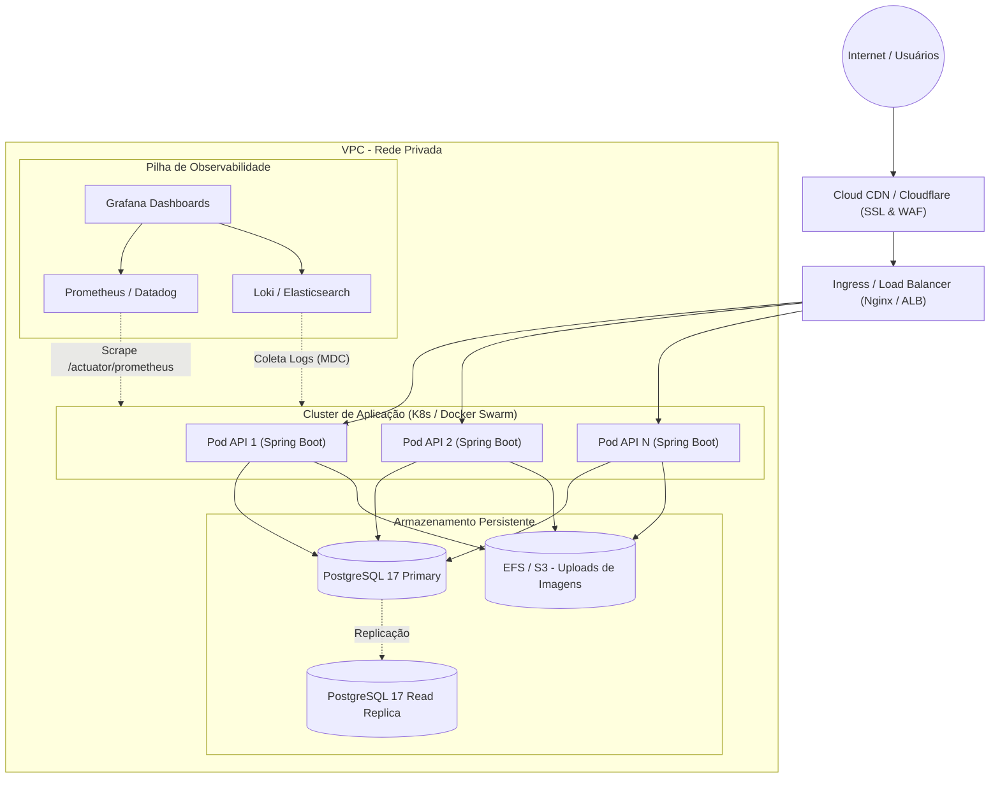

# Guia Operacional, Deploy e Resolução de Problemas — Duolinfo

Este documento orienta engenheiros de software, SREs e administradores de infraestrutura na operação contínua, homologação, monitoramento e sustentação do **Duolinfo** em ambientes de produção.

---

## Sumário

1. [Topologia de Produção e Arquitetura de Implantação](#topologia-de-produção-e-arquitetura-de-implantação)
2. [Configurações de Produção e Validação de Segurança](#configurações-de-produção-e-validação-de-segurança)
3. [Estratégia de Banco de Dados e Migrations](#estratégia-de-banco-de-dados-e-migrations)
4. [Procedimentos de Backup e Restauração](#procedimentos-de-backup-e-restauração)
5. [Gestão de Logs e Auditoria](#gestão-de-logs-e-auditoria)
6. [Monitoramento, Métricas e Probes](#monitoramento-métricas-e-probes)
7. [Procedimentos de Deploy e Atualização Contínua](#procedimentos-de-deploy-e-atualização-contínua)
8. [Runbook de Diagnóstico e Resolução de Incidentes](#runbook-de-diagnóstico-e-resolução-de-incidentes)

---

## Topologia de Produção e Arquitetura de Implantação

Em ambiente de alta disponibilidade, o Duolinfo opera com isolamento entre a camada pública e os nós de processamento interno:



---

## Configurações de Produção e Validação de Segurança

### Validação Rígida no Boot (`ProductionSecurityValidator`)
Quando o perfil `SPRING_PROFILES_ACTIVE=prod` está ativo, a classe `ProductionSecurityValidator` executa verificações de conformidade antes de abrir portas para tráfego. A aplicação **aborta imediatamente** caso:
- `JWT_SECRET` tenha menos de 32 bytes ou seja o valor padrão de desenvolvimento.
- `POSTGRES_PASSWORD` utilize a senha padrão `duolingo_dev_password` ou `postgres`.
- `APP_ADMIN_EMAILS` não esteja explicitamente configurado.
- `APP_ADMIN_INITIAL_PASSWORD` seja menor que 12 caracteres ou contenha senhas triviais.

### Matriz de Variáveis Obrigatórias
```bash
# Segurança & JWT
SPRING_PROFILES_ACTIVE=prod
JWT_SECRET=<segredo_criptografico_gerado_com_openssl>
APP_ADMIN_EMAILS=coordenacao@escola.edu.br,infra@duolinfo.com.br
APP_ADMIN_INITIAL_PASSWORD=<senha_forte_inicial_com_mais_de_12_chars>

# Banco de Dados PostgreSQL
SPRING_DATASOURCE_URL=jdbc:postgresql://postgres.internal:5432/duolingo?sslmode=require
SPRING_DATASOURCE_USERNAME=duolingo_prod
SPRING_DATASOURCE_PASSWORD=<senha_forte_do_banco>
SPRING_DATASOURCE_HIKARI_MAXIMUM_POOL_SIZE=30
SPRING_DATASOURCE_HIKARI_MINIMUM_IDLE=10

# Provedores Externos
GOOGLE_CLIENT_ID=367385027390-dmuj8neeqpgcbph3uk9qfb2cs5ubldhp.apps.googleusercontent.com
AI_API_KEY=<chave_privada_google_gemini>
AI_MODEL=gemini-3.5-flash-lite

# CORS & Frontend
CORS_ALLOWED_ORIGINS=https://app.duolinfo.com.br,https://portal.duolinfo.com.br
APP_FRONTEND_URL=https://app.duolinfo.com.br
```

---

## Estratégia de Banco de Dados e Migrations

A integridade do banco é mantida estritamente através do **Flyway**:

1. **Desativação de DDL Automático**:
   - `spring.jpa.hibernate.ddl-auto=validate` em produção.
   - O Hibernate apenas valida o esquema contra as entidades JPA; ele nunca altera ou remove colunas automaticamente em produção.
2. **Ciclo de Migrations**:
   - As migrations residem em `src/main/resources/db/migration/`.
   - `V1__initial_schema.sql`: Estrutura de tabelas base.
   - `V2__performance_indexes_and_integrity_constraints.sql`: Otimizações, índices de concorrência e coluna `version` de lock otimista.
3. **Regras de Versionamento**:
   - Arquivos versionados (`V<N>__<descricao>.sql`) são estritamente imutáveis após commit.
   - Qualquer modificação de esquema em produção exige a criação do arquivo `V3__...` subsequente.

---

## Procedimentos de Backup e Restauração

### 1. Backup Lógico Quente com `pg_dump`
Para realizar o backup sem interrupção de serviço:

```bash
# Executado diariamente via cronjob ou AWS Lambda
TIMESTAMP=$(date +"%Y%m%d_%H%M%S")
BACKUP_DIR="/backups/postgresql"
mkdir -p "$BACKUP_DIR"

PGPASSWORD="$POSTGRES_PASSWORD" pg_dump \
  -h localhost \
  -p 5432 \
  -U duolingo \
  -d duolingo \
  -F c \
  -b \
  -v \
  -f "$BACKUP_DIR/duolingo_backup_${TIMESTAMP}.dump"

# Envio criptografado para Bucket S3 / Cloud Storage
aws s3 cp "$BACKUP_DIR/duolingo_backup_${TIMESTAMP}.dump" s3://duolinfo-backups/database/
```

### 2. Procedimento de Restauração com `pg_restore`
Em caso de desastre ou recuperação de ambiente de homologação:

```bash
# 1. Parar a API para evitar escritas parciais
docker compose stop api

# 2. Restaurar schema e dados em banco limpo
PGPASSWORD="$POSTGRES_PASSWORD" pg_restore \
  -h localhost \
  -p 5432 \
  -U duolingo \
  -d duolingo \
  --clean \
  --if-exists \
  -v "/backups/postgresql/duolingo_backup_YYYYMMDD_HHMMSS.dump"

# 3. Reiniciar a API
docker compose start api
```

### 3. Backup de Mídias Persistentes
O diretório de imagens de perfil (`/app/uploads/profile-pictures`) deve ser sincronizado periodicamente para um bucket de armazenamento durável:
```bash
aws s3 sync /var/lib/docker/volumes/profile-pictures/_data s3://duolinfo-backups/media/profile-pictures/
```

---

## Gestão de Logs e Auditoria

### Logging Estruturado e MDC
A aplicação utiliza o Logback estruturado configurado em `logback-spring.xml`:
- **Correlation ID**: Cada linha de log possui o identificador `[%X{correlationId}]`. Se o cliente não enviar um header `X-Correlation-Id`, a aplicação gera um UUID único no primeiro filtro HTTP.
- **Formato ISO-8601**: Permite ordenação cronológica precisa e ingestão automática pelo Loki, FluentBit ou Filebeat.

Exemplo de log emitido:
```text
2026-11-11T00:41:03.421Z INFO  [           main] [req-1710000000-abcd12] c.d.ia.proj.config.CorrelationIdFilter   : HTTP Request: method=GET uri=/api/catalog/languages remoteIp=127.0.0.1 correlationId=req-1710000000-abcd12
```

### Rotação de Logs
Em implantações bare-metal, os logs são rotacionados diariamente mantendo histórico compactado de 30 dias com teto de 10GB por arquivo.

---

## Monitoramento, Métricas e Probes

### Endpoints do Spring Boot Actuator
| Endpoint | Tipo de Acesso | Utilização |
| :--- | :---: | :--- |
| `/actuator/health` | **Público** | Monitoramento de liveness pelo Load Balancer e orquestrador |
| `/actuator/health/liveness` | **Público** | Kubernetes Liveness Probe (reinicia o pod se travar) |
| `/actuator/health/readiness`| **Público** | Kubernetes Readiness Probe (bloqueia tráfego se BD fora) |
| `/actuator/info` | **Público** | Metadados da versão implantada |
| `/actuator/metrics` | **Protegido (`ROLE_ADMIN`)** | Métricas internas do Micrometer |
| `/actuator/prometheus` | **Protegido** | Raspagem de métricas de CPU, Heap e conexões de banco |

### Configuração de Probes no Kubernetes (`deployment.yaml`)
```yaml
livenessProbe:
  httpGet:
    path: /actuator/health/liveness
    port: 8080
  initialDelaySeconds: 45
  periodSeconds: 10
  timeoutSeconds: 5
  failureThreshold: 3
readinessProbe:
  httpGet:
    path: /actuator/health/readiness
    port: 8080
  initialDelaySeconds: 20
  periodSeconds: 10
  timeoutSeconds: 3
  failureThreshold: 2
```

### Alertas Críticos Recomendados (Grafana / Prometheus)
1. **Saturação do HikariCP**: Alerta quando `hikaricp.connections.pending > 5` por mais de 1 minuto.
2. **Latência de API Elevada**: Alerta quando o percentil 95 (P95) de tempo de resposta em `/api/**` exceder 1500ms.
3. **Taxa de Erros 5xx**: Alerta quando requisições com código 5xx representarem mais de 1% do tráfego total em janela de 5 minutos.
4. **Indisponibilidade de Provedor de IA**: Alerta quando `ExternalAiHealthIndicator` reportar status `DOWN` ou falha contínua de quotas na API Gemini.

---

## Procedimentos de Deploy e Atualização Contínua

### Deploy Sem Indisponibilidade (*Rolling Update*)
1. **Etapa de Pré-Migração**:
   - Em caso de nova migration do Flyway com índices novos, aplique-a antes da troca de containers (`./mvnw flyway:migrate`).
2. **Atualização Gradual de Pods**:
   - O orquestrador inicia os novos containers com a versão atualizada da imagem.
   - O nó aguarda o endpoint `/actuator/health/readiness` responder `UP` antes de redirecionar tráfego.
   - Os nós legados processam as conexões abertas e são finalizados de forma suave (*graceful shutdown*).

---

## Runbook de Diagnóstico e Resolução de Incidentes

### 1. Investigação com Correlation ID
Quando um usuário ou equipe relatar um erro na plataforma com o identificador retornado na interface:
1. Obtenha o código `correlationId` (ex.: `c71a7177-1db7-40bc-9d5d-7cd65610af76`).
2. Realize a consulta no sistema de logs:
   ```bash
   # Via terminal no host
   docker compose logs api | grep "c71a7177-1db7-40bc-9d5d-7cd65610af76"
   
   # Via Loki / Grafana LogCLI
   {app="duolinfo-backend"} |= "c71a7177-1db7-40bc-9d5d-7cd65610af76"
   ```
3. O log revelará a requisição original, parâmetros recebidos, stack trace completo (caso tenha ocorrido exceção 500) e tempo total de resposta.

### 2. Saturação de Conexões com o PostgreSQL
- **Sintoma**: Requisições falhando com código 500 e mensagem `ConnectionTimeoutException: Connection is not available, request timed out after 30000ms`.
- **Causa**: Consultas lentas prendendo conexões no HikariCP ou número de pods simultâneos excedendo o `max_connections` do PostgreSQL.
- **Ação Imediata**:
  1. Identifique consultas travadas no PostgreSQL:
     ```sql
     SELECT pid, age(clock_timestamp(), query_start), usename, state, query 
     FROM pg_stat_activity 
     WHERE state != 'idle' AND query NOT ILIKE '%pg_stat_activity%' 
     ORDER BY query_start ASC;
     ```
  2. Finalize processos travados:
     ```sql
     SELECT pg_terminate_backend(<pid>);
     ```
  3. Incremente temporariamente o `max_connections` no `postgresql.conf` e utilize PgBouncer como pooling intermediário caso o cluster possua mais de 10 pods.

### 3. Falha ou Lentidão na API de IA (Google Gemini)
- **Sintoma**: Geração de exercícios ou explicações didáticas com erro ou lentidão.
- **Causa**: Exaustão da cota da chave de API no Google Cloud ou indisponibilidade temporária do serviço externo.
- **Ação Imediata**:
  1. Verifique o status da chave no Google Cloud Console.
  2. Substitua a variável `AI_API_KEY` por uma chave secundária e execute `docker compose up -d --no-deps api` para recarregar sem indisponibilidade.
  3. A aplicação mantém isolamento de falhas: outros serviços (exercícios manuais, avaliações, matrículas e ofensiva) continuarão operando normalmente.

### 4. Erro de Concorrência Otimista (HTTP 409 Conflict)
- **Sintoma**: Usuário recebe `409 Conflict` ao tentar salvar edições simultâneas de perfil ou turma.
- **Causa**: O registro foi modificado por outra sessão enquanto a tela estava aberta (controle `@Version`).
- **Ação Imediata**: O frontend instrui o usuário a recarregar os dados mais recentes antes de reaplicar suas alterações, prevenindo sobrescrita inadvertida de dados (*lost updates*).
