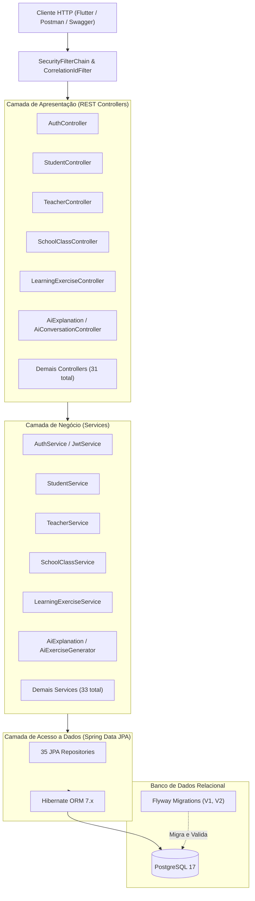
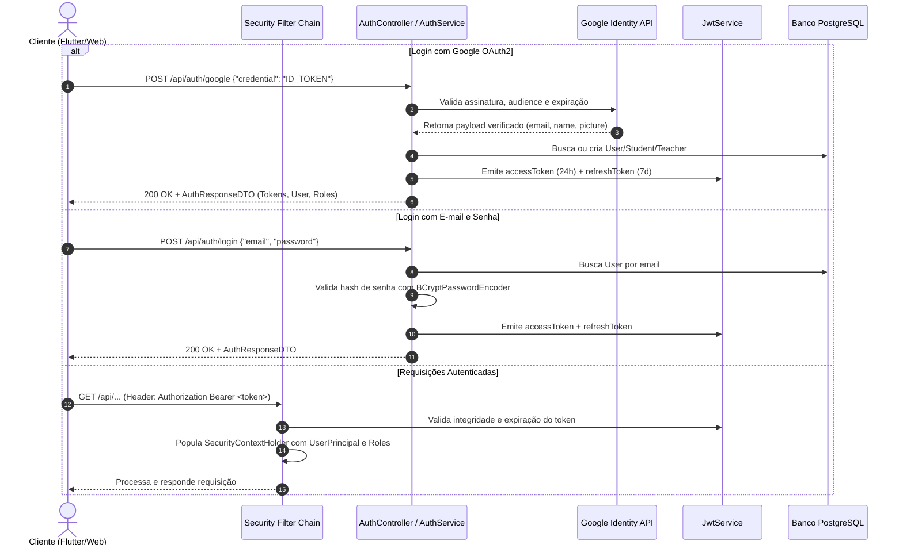
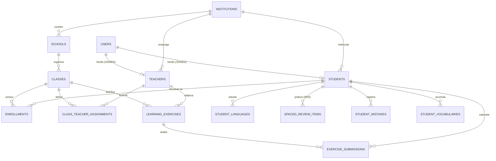

# Backend Duolinfo — Spring Boot & PostgreSQL

API RESTful de alto desempenho para a plataforma de aprendizagem de idiomas **Duolinfo**, construída com **Java 17 (LTS)** e **Spring Boot 4.1.1**, com persistência relacional em **PostgreSQL 17**, controle de versões de banco de dados via **Flyway**, autenticação híbrida com **JWT e Google OAuth2**, e observabilidade em tempo real com **Spring Boot Actuator** e **Correlation IDs**.

---

## Sumário

1. [Visão Geral da Arquitetura](#visão-geral-da-arquitetura)
2. [Stack Tecnológico e Dependências](#stack-tecnológico-e-dependências)
3. [Segurança e Autenticação](#segurança-e-autenticação)
4. [Tratamento Global de Exceções](#tratamento-global-de-exceções)
5. [Catálogo Completo de Endpoints RESTful](#catálogo-completo-de-endpoints-restful)
6. [Modelo de Dados, Persistência e Migrations](#modelo-de-dados-persistência-e-migrations)
7. [Observabilidade, Logging e Monitoramento](#observabilidade-logging-e-monitoramento)
8. [Configuração do Ambiente e Variáveis](#configuração-do-ambiente-e-variáveis)
9. [Instruções de Execução e Desenvolvimento](#instruções-de-execução-e-desenvolvimento)
10. [Execução da Suíte de Testes](#execução-da-suíte-de-testes)
11. [Convenções de Desenvolvimento e Qualidade](#convenções-de-desenvolvimento-e-qualidade)

---

## Visão Geral da Arquitetura

O backend foi estruturado seguindo o padrão em camadas desacopladas (*Layered Architecture*), com forte isolamento de responsabilidades:



### Divisão de Responsabilidades
- **`com.duolinfo.ia.proj.config`**: Configurações transversais de infraestrutura: segurança (Spring Security), CORS, OpenAPI/Swagger, filtros de rastreamento (`CorrelationIdFilter`) e indicadores de saúde (`ExternalAiHealthIndicator`).
- **`com.duolinfo.ia.proj.controller`**: Controladores RESTful responsáveis por desserializar payloads, validar restrições com Bean Validation (`@Valid`), aplicar autorização e retornar códigos HTTP semânticos.
- **`com.duolinfo.ia.proj.service`**: Lógica de negócio, regras pedagógicas, transações atômicas (`@Transactional`), orquestração de IA e comunicação assíncrona.
- **`com.duolinfo.ia.proj.repository`**: Interfaces que estendem `JpaRepository`, consultas otimizadas com `@EntityGraph` para evitar N+1 queries e repositórios SQL nativos.
- **`com.duolinfo.ia.proj.entity`**: Entidades mapeadas para o banco com anotações JPA/Hibernate, validações em ciclo de vida e controle de versão para concorrência otimista (`@Version`).
- **`com.duolinfo.ia.proj.dto`**: Objetos de transferência de dados (*Requests* e *Responses*) para garantir desacoplamento entre banco e API pública.

---

## Stack Tecnológico e Dependências

As principais dependências gerenciadas no `pom.xml` incluem:

| Categoria | Dependência / Tecnologia | Versão | Propósito |
| :--- | :--- | :---: | :--- |
| **Linguagem** | Java OpenJDK | 17 LTS | Plataforma de execução |
| **Framework** | Spring Boot | 4.1.1 | Starter Parent e autoconfiguração |
| **Web MVC** | `spring-boot-starter-webmvc` | 4.1.1 | DispatcherServlet, REST e SSE |
| **Segurança** | `spring-boot-starter-security` | 4.1.1 | Filtros de autenticação e RBAC |
| **Tokens JWT** | `jjwt-api`, `jjwt-impl`, `jjwt-gson` | 0.12.5 | Emissão e validação de tokens JWT |
| **OAuth2 Google** | `google-api-client` | 2.9.0 | Validação de Google ID Tokens |
| **Persistência** | `spring-boot-starter-data-jpa` | 4.1.1 | Spring Data JPA e Hibernate 7 |
| **Driver BD** | `postgresql` | Runtime | Driver JDBC oficial PostgreSQL |
| **Migrations** | `flyway-core`, `flyway-database-postgresql` | 11.x | Versionamento determinístico de schema |
| **Observabilidade** | `spring-boot-starter-actuator` | 4.1.1 | Health checks, metrics e auditoria |
| **OpenAPI** | `springdoc-openapi-starter-webmvc-ui` | 2.8.5 | Swagger UI e spec OpenAPI 3.0 |
| **Produtividade** | `lombok` | 1.18.36 | Redução de boilerplate (getters, setters, builders) |

---

## Segurança e Autenticação

A segurança é centralizada no [`SecurityConfig.java`](file:///home/antigravity/samuelbueno123/duolingo-com-ia/backend/src/main/java/com/duolinfo/ia/proj/config/SecurityConfig.java).



### Papéis e Autorização (RBAC)
- **`ROLE_USER`**: Usuário cadastrado sem perfil docente ou discente vinculado.
- **`ROLE_STUDENT`**: Estudante matriculado em turmas ou estudando de forma autônoma.
- **`ROLE_TEACHER`**: Professor aprovado com acesso ao estúdio de aulas e turmas.
- **`ROLE_INSTITUTION_ADMIN`**: Gestor de instituição responsável pela homologação de docentes e turmas da sua rede.
- **`ROLE_ADMIN`**: Administrador mestre da plataforma.

---

## Tratamento Global de Exceções

O [`GlobalExceptionHandler.java`](file:///home/antigravity/samuelbueno123/duolingo-com-ia/backend/src/main/java/com/duolinfo/ia/proj/exception/GlobalExceptionHandler.java) intercepta todas as exceções lançadas pela aplicação e as converte no formato padronizado [`ApiErrorResponse`](file:///home/antigravity/samuelbueno123/duolingo-com-ia/backend/src/main/java/com/duolinfo/ia/proj/dto/response/ApiErrorResponse.java):

```json
{
  "timestamp": "2026-11-11T00:41:03.409Z",
  "status": 400,
  "error": "Bad Request",
  "message": "Erro de validação nos dados enviados",
  "path": "/api/classes",
  "correlationId": "60952535-5f6a-46c6-bb8e-20c37e66c0b3",
  "validationErrors": {
    "name": "O nome da turma é obrigatório"
  }
}
```

- **400 Bad Request**: Falhas de validação de DTOs, parâmetros obrigatórios ausentes.
- **401 Unauthorized**: Falhas de credencial, token ausente ou expirado.
- **403 Forbidden**: Acesso negado a rotas restritas.
- **404 Not Found**: Recursos não localizados.
- **409 Conflict**: Concorrência otimista (`OptimisticLockingFailureException`) e violações de unicidade (`DataIntegrityViolationException`).
- **500 Internal Server Error**: Falhas internas inesperadas registradas com Correlation ID no log, sem exposição de stack traces ao cliente.

---

## Catálogo Completo de Endpoints RESTful

A API do Duolinfo possui **31 controladores** divididos por domínios pedagógicos e operacionais:

### 1. Autenticação e Sessão (`/api/auth`)
| Método | Endpoint | Autenticação | Descrição |
| :--- | :--- | :---: | :--- |
| `POST` | `/api/auth/google` | Pública | Login ou cadastro com Google ID Token |
| `POST` | `/api/auth/login` | Pública | Autenticação com e-mail e senha local |
| `POST` | `/api/auth/forgot-password` | Pública | Solicitação de link de redefinição de senha por e-mail |
| `POST` | `/api/auth/reset-password` | Pública | Redefinição de senha utilizando token recebido |
| `POST` | `/api/auth/refresh` | Pública | Emissão de novo `accessToken` a partir de `refreshToken` válido |
| `GET` | `/api/auth/me` | Bearer Token | Dados do usuário autenticado no token atual |
| `PUT` | `/api/auth/me` | Bearer Token | Atualização de nome e dados básicos da própria conta |
| `GET` | `/api/auth/me/preferences` | Bearer Token | Consulta de preferências (tema, notificações, idioma) |
| `PUT` | `/api/auth/me/preferences` | Bearer Token | Atualização de preferências do usuário logado |
| `DELETE` | `/api/auth/me` | Bearer Token | Exclusão da própria conta pelo usuário |
| `POST` | `/api/auth/logout` | Bearer Token | Invalidação de sessão e encerramento |

### 2. Estudantes (`/api/students`)
| Método | Endpoint | Autenticação | Descrição |
| :--- | :--- | :---: | :--- |
| `POST` | `/api/students` | Pública | Cadastro de novo estudante |
| `GET` | `/api/students` | Autenticado | Listagem paginada de estudantes |
| `GET` | `/api/students/me` | `STUDENT` | Dados completos do perfil do aluno autenticado |
| `PUT` | `/api/students/me` | `STUDENT` | Atualização do próprio perfil de estudante |
| `POST` | `/api/students/me/enroll` | `STUDENT` | Auto-matrícula em turma disponível |
| `DELETE` | `/api/students/me/enrollments/{id}` | `STUDENT` | Cancelamento de matrícula pelo próprio aluno |
| `GET` | `/api/students/me/available-classes`| `STUDENT` | Consulta de turmas disponíveis na sua instituição |
| `GET` | `/api/students/{id}` | Autenticado | Detalhes de estudante por ID |
| `GET` | `/api/students/language/{lang}` | Autenticado | Busca de estudantes por idioma de estudo |
| `PUT` | `/api/students/{id}` | `ADMIN` / Dono | Atualização de estudante por ID |
| `DELETE` | `/api/students/{id}` | `ADMIN` | Exclusão de estudante |

### 3. Gamificação de Ofensiva (`/api/students/me/streak`)
| Método | Endpoint | Autenticação | Descrição |
| :--- | :--- | :---: | :--- |
| `GET` | `/api/students/me/streak` | `STUDENT` | Consulta dados da ofensiva (dias, congelamentos, meta) |
| `POST` | `/api/students/me/streak/goal` | `STUDENT` | Atualiza meta diária de estudos (minutos/exercícios) |
| `POST` | `/api/students/me/streak/freeze/buy`| `STUDENT` | Adquire bloqueio de ofensiva utilizando pontos |

### 4. Caderno de Erros Inteligente (`/api/students/me/mistakes`)
| Método | Endpoint | Autenticação | Descrição |
| :--- | :--- | :---: | :--- |
| `GET` | `/api/students/me/mistakes` | `STUDENT` | Lista histórico de erros cometidos pelo aluno |
| `GET` | `/api/students/me/mistakes/stats` | `STUDENT` | Estatísticas de resolução e principais áreas de falha |
| `POST` | `/api/students/me/mistakes/{id}/review` | `STUDENT` | Marca erro como revisado/resolvido |

### 5. Glossário e Vocabulário Pessoal (`/api/students/me/vocabulary`)
| Método | Endpoint | Autenticação | Descrição |
| :--- | :--- | :---: | :--- |
| `GET` | `/api/students/me/vocabulary` | `STUDENT` | Consulta termos salvos (com filtro por idioma e domínio) |
| `POST` | `/api/students/me/vocabulary` | `STUDENT` | Adiciona novo termo com tradução e notas de contexto |
| `PATCH` | `/api/students/me/vocabulary/{id}/mastery` | `STUDENT` | Atualiza nível de maestria do vocabulário (1-5) |
| `DELETE` | `/api/students/me/vocabulary/{id}` | `STUDENT` | Remove termo do vocabulário |

### 6. Notificações do Estudante (`/api/students/me/notifications`)
| Método | Endpoint | Autenticação | Descrição |
| :--- | :--- | :---: | :--- |
| `GET` | `/api/students/me/notifications` | `STUDENT` | Lista notificações recebidas |
| `GET` | `/api/students/me/notifications/unread-count` | `STUDENT` | Contagem de alertas não lidos |
| `PATCH` | `/api/students/me/notifications/{id}/read` | `STUDENT` | Marca notificação específica como lida |
| `POST` | `/api/students/me/notifications/read-all` | `STUDENT` | Marca todas as notificações como lidas |

### 7. Professores (`/api/teachers`)
| Método | Endpoint | Autenticação | Descrição |
| :--- | :--- | :---: | :--- |
| `POST` | `/api/teachers` | Pública | Cadastro de professor (inicia com `approved: false`) |
| `GET` | `/api/teachers` | Autenticado | Listagem de docentes cadastrados |
| `GET` | `/api/teachers/me` | `TEACHER` | Perfil do professor autenticado |
| `GET` | `/api/teachers/{id}` | Autenticado | Consulta de docente por ID |
| `GET` | `/api/teachers/institution/{instId}`| Autenticado | Docentes vinculados a uma instituição |
| `PUT` | `/api/teachers/{id}` | `TEACHER` / `ADMIN` | Atualização cadastral do docente |
| `PATCH` | `/api/teachers/{id}/approval` | `ADMIN` / InstAdmin | Homologação ou suspensão do docente |
| `DELETE` | `/api/teachers/{id}` | `ADMIN` | Exclusão de registro docente |

### 8. Anotações Pedagógicas dos Professores (`/api/teachers/me/notes`)
| Método | Endpoint | Autenticação | Descrição |
| :--- | :--- | :---: | :--- |
| `GET` | `/api/teachers/me/notes` | `TEACHER` | Lista anotações confidenciais feitas sobre alunos |
| `POST` | `/api/teachers/me/notes` | `TEACHER` | Registra nova nota pedagógica sobre um estudante |
| `DELETE` | `/api/teachers/me/notes/{id}` | `TEACHER` | Exclui nota pedagógica |

### 9. Estúdio de Exercícios e IA (`/api/exercises`)
| Método | Endpoint | Autenticação | Descrição |
| :--- | :--- | :---: | :--- |
| `GET` | `/api/exercises` | Autenticado | Listagem de exercícios com filtros de turma e disciplina |
| `POST` | `/api/exercises` | `TEACHER` | Criação manual de exercício pedagógico |
| `POST` | `/api/exercises/{id}/clone` | `TEACHER` | Clona exercício existente para outra turma |
| `POST` | `/api/exercises/generate-ai` | `TEACHER` | Geração automática de exercícios via Gemini |
| `POST` | `/api/exercises/generate-options-ai` | `TEACHER` | Geração de alternativas distratoras com IA |
| `POST` | `/api/exercises/explain-ai` | Autenticado | Solicita explicação didática do exercício à IA |
| `POST` | `/api/exercises/{id}/submissions` | `STUDENT` | Submissão de resposta pelo aluno com pontuação automática |
| `GET` | `/api/exercises/{id}/my-submission`| `STUDENT` | Consulta resposta submetida pelo próprio aluno |
| `GET` | `/api/exercises/submissions` | `TEACHER` | Submissões da turma para revisão |
| `PATCH` | `/api/exercises/submissions/{id}/feedback` | `TEACHER` | Atribuição de feedback e nota manual |

### 10. Turmas, Comunicados e Analítica (`/api/classes`)
| Método | Endpoint | Autenticação | Descrição |
| :--- | :--- | :---: | :--- |
| `POST` | `/api/classes/my-institution` | `TEACHER` / InstAdmin | Criação de turma na instituição do usuário logado |
| `GET` | `/api/classes` | Autenticado | Lista turmas |
| `GET` | `/api/classes/{id}/dashboard` | Autenticado | Métricas detalhadas de desempenho da turma |
| `GET` | `/api/classes/{id}/analytics` | `TEACHER` / `ADMIN` | Analítica preditiva de estudantes em risco |
| `GET` | `/api/classes/{id}/announcements` | Autenticado | Mural de recados e comunicados da turma |
| `POST` | `/api/classes/{id}/announcements` | `TEACHER` | Publica comunicado com opção de urgência |
| `DELETE` | `/api/classes/announcements/{id}` | `TEACHER` / `ADMIN` | Remove comunicado do mural |
| `PATCH` | `/api/classes/{id}/activate` | `ADMIN` / InstAdmin | Ativa turma |
| `PATCH` | `/api/classes/{id}/deactivate` | `ADMIN` / InstAdmin | Desativa turma |

### 11. Conversação Interativa com IA (`/api/ai/conversations`)
| Método | Endpoint | Autenticação | Descrição |
| :--- | :--- | :---: | :--- |
| `GET` | `/api/ai/conversations/scenarios`| Autenticado | Lista cenários disponíveis (restaurante, aeroporto, etc.) |
| `POST` | `/api/ai/conversations/start` | `STUDENT` | Inicia sessão de diálogo interativo em idioma alvo |
| `POST` | `/api/ai/conversations/{id}/messages`| `STUDENT` | Envia mensagem na conversa e recebe réplica da IA com feedback |
| `GET` | `/api/ai/conversations/{id}` | `STUDENT` | Histórico completo de mensagens e correções |
| `POST` | `/api/ai/conversations/{id}/end` | `STUDENT` | Finaliza diálogo e gera avaliação final |

### 12. Prática de Pronúncia (`/api/pronunciation`)
| Método | Endpoint | Autenticação | Descrição |
| :--- | :--- | :---: | :--- |
| `GET` | `/api/pronunciation/challenges` | Autenticado | Lista sentenças e desafios fonéticos por nível |
| `POST` | `/api/pronunciation/evaluate` | `STUDENT` | Submete áudio/transcrição para cálculo de pontuação fonética |
| `GET` | `/api/pronunciation/history` | `STUDENT` | Histórico de tentativas do aluno |
| `GET` | `/api/pronunciation/stats` | `STUDENT` | Indicadores de evolução de acurácia de fala |

### 13. Repetição Espaçada - SRS (`/api/srs`)
| Método | Endpoint | Autenticação | Descrição |
| :--- | :--- | :---: | :--- |
| `GET` | `/api/srs/session` | `STUDENT` | Carrega cartões devidos para revisão no dia (SM-2) |
| `POST` | `/api/srs/review/{itemId}` | `STUDENT` | Registra avaliação (0 a 5) e recalcula próximo intervalo |
| `GET` | `/api/srs/items` | `STUDENT` | Todos os cartões cadastrados |
| `POST` | `/api/srs/items` | `STUDENT` | Cria novo cartão de estudo |
| `DELETE` | `/api/srs/items/{itemId}` | `STUDENT` | Remove cartão |

### 14. Revisão Comunitária por Pares (`/api/community`)
| Método | Endpoint | Autenticação | Descrição |
| :--- | :--- | :---: | :--- |
| `POST` | `/api/community/submissions` | `STUDENT` | Publica redação para avaliação comunitária |
| `GET` | `/api/community/feed` | Autenticado | Feed de textos abertos para correção |
| `POST` | `/api/community/reviews` | `STUDENT` | Submete crítica, nota e sugestões de melhoria |
| `POST` | `/api/community/reports` | Autenticado | Denuncia publicação inadequada para moderação |

### 15. Trilha Pedagógica CEFR (`/api/learning-path`)
| Método | Endpoint | Autenticação | Descrição |
| :--- | :--- | :---: | :--- |
| `GET` | `/api/learning-path/me` | `STUDENT` | Trilha de aprendizagem e módulos desbloqueados |
| `GET` | `/api/learning-path/diagnostic` | `STUDENT` | Teste de nivelamento inicial |
| `POST` | `/api/learning-path/diagnostic` | `STUDENT` | Submete nivelamento para posicionamento na trilha |
| `POST` | `/api/learning-path/modules/{id}/complete` | `STUDENT` | Conclui módulo e avança progresso |

### 16. Tempo Real SSE (`/api/realtime`)
| Método | Endpoint | Autenticação | Descrição |
| :--- | :--- | :---: | :--- |
| `GET` | `/api/realtime/stream` | Token na Query | Canal Server-Sent Events para notificações e sincronização |

### 17. Administração e Governança (`/api/admin`)
| Método | Endpoint | Autenticação | Descrição |
| :--- | :--- | :---: | :--- |
| `GET` | `/api/admin/tables` | `ADMIN` | Lista tabelas gerenciadas |
| `GET` | `/api/admin/tables/{table}/rows` | `ADMIN` | Consulta linhas de tabela com paginação |
| `GET` | `/api/admin/users` | `ADMIN` | Consulta e gestão de todos os usuários |
| `PATCH` | `/api/admin/users/{id}/admin` | `ADMIN` | Concede ou revoga permissão de administrador |
| `PATCH` | `/api/admin/teachers/{id}/institution-admin` | `ADMIN` | Concede perfil de gestor escolar |
| `GET` | `/api/admin/institution-requests`| `ADMIN` | Lista solicitações de adesão institucional |
| `PATCH` | `/api/admin/institution-requests/{id}` | `ADMIN` | Aprova ou rejeita adesão institucional |

### 18. Monitoramento e Saúde (`/actuator`)
| Método | Endpoint | Autenticação | Descrição |
| :--- | :--- | :---: | :--- |
| `GET` | `/actuator/health` | Pública | Health check geral da aplicação |
| `GET` | `/actuator/health/liveness` | Pública | Probe de liveness (Kubernetes) |
| `GET` | `/actuator/health/readiness` | Pública | Probe de readiness (Kubernetes) |
| `GET` | `/actuator/info` | Pública | Metadados de versão |
| `GET` | `/actuator/metrics` | `ADMIN` | Consulta métricas operacionais e JVM |

---

## Modelo de Dados, Persistência e Migrations

O banco é gerido pelo **Flyway**, garantindo reprodutibilidade em todos os ambientes:

### Migrations
1. **`V1__initial_schema.sql`**: Define as 35 tabelas estruturais, chaves primárias, relacionamentos `ON DELETE CASCADE` ou `ON DELETE RESTRICT`, tipos enum e sequências.
2. **`V2__performance_indexes_and_integrity_constraints.sql`**: Adiciona a coluna `version` em `users` para concorrência otimista, índices únicos parciais (evitando matrículas ativas duplicadas e duplicidade de professores na mesma turma) e 28 índices estratégicos de consulta de alta performance.

### Principais Entidades e Relacionamentos


---

## Observabilidade, Logging e Monitoramento

1. **Correlation IDs**: Toda requisição recebe ou preserva um `X-Correlation-Id`, injetado no MDC do SLF4J por [`CorrelationIdFilter`](file:///home/antigravity/samuelbueno123/duolingo-com-ia/backend/src/main/java/com/duolinfo/ia/proj/config/CorrelationIdFilter.java).
2. **Logback Estruturado**: O [`logback-spring.xml`](file:///home/antigravity/samuelbueno123/duolingo-com-ia/backend/src/main/resources/logback-spring.xml) formata logs com timestamps UTC ISO-8601, níveis, identificadores de thread e `correlationId`.
3. **Indicador de Saúde de IA (`ExternalAiHealthIndicator`)**: Monitora a conectividade com a API Gemini sem travar a inicialização da API em ambientes sem chaves ativas.

---

## Configuração do Ambiente e Variáveis

O backend lê configurações via `application.properties`, sobrescritas por variáveis de ambiente:

| Variável de Ambiente | Descrição | Padrão (Dev) | Obrigatório em Prod? |
| :--- | :--- | :--- | :---: |
| `JWT_SECRET` | Chave secreta HMAC para assinatura de tokens (>= 32 bytes) | *Valor dev randômico* | **Sim** |
| `SPRING_DATASOURCE_URL` | URL JDBC de conexão ao PostgreSQL | `jdbc:postgresql://localhost:5432/duolingo` | **Sim** |
| `SPRING_DATASOURCE_USERNAME` | Usuário do banco de dados | `duolingo` | **Sim** |
| `SPRING_DATASOURCE_PASSWORD` | Senha do banco de dados | `duolingo_dev_password` | **Sim** |
| `APP_ADMIN_EMAILS` | E-mails autorizados para primeiro acesso como ADMIN | `admin@duolingo.com` | **Sim** |
| `AI_API_KEY` | Chave de API do Google Gemini AI | *Chave de homologação* | **Sim** |
| `AI_MODEL` | Modelo de IA utilizado para desafios e conversação | `gemini-3.5-flash-lite` | Não |
| `CORS_ALLOWED_ORIGINS` | Origens autorizadas separadas por vírgula | `http://localhost:3000,http://localhost:5000` | **Sim** |
| `SPRING_MAIL_HOST` | Host do servidor SMTP para envio de recuperação de senha | `smtp.gmail.com` | Opcional |

---

## Instruções de Execução e Desenvolvimento

### Execução Local com PostgreSQL via Docker
1. Suba o banco de dados:
   ```bash
   docker compose up -d postgres
   ```
2. Inicie a API no host utilizando o Maven Wrapper:
   ```bash
   ./mvnw spring-boot:run
   ```
   *(No Windows utilize `.\mvnw.cmd spring-boot:run`)*

### Execução Completa via Docker Compose
Para iniciar a API e o PostgreSQL conteinerizados:
```bash
docker compose up --build -d
```

### Documentação OpenAPI / Swagger UI
Com a aplicação em execução, acesse no navegador:
- **Swagger UI**: `http://localhost:8080/swagger-ui/index.html`
- **OpenAPI JSON**: `http://localhost:8080/v3/api-docs`

---

## Execução da Suíte de Testes

Para executar toda a suíte de testes unitários, integração e persistência:

```bash
./mvnw test
```

### Principais Classes de Teste
- **`ProductionReliabilityAndMonitoringTest`**: Valida geração e propagação de Correlation IDs, segurança de Actuator, health indicators e serialização de `ApiErrorResponse`.
- **`DatabasePersistenceAndConcurrencyIntegrationTest`**: Valida concorrência otimista (`@Version`), locks de matrícula e índices únicos do Flyway V2.
- **`SecurityAndLearningTests`**: Valida isolamento de rotas por perfis e autorização de endpoints de ensino.
- **`AuthControllerIntegrationTest`**: Valida autenticação Google e login local.

---

## Convenções de Desenvolvimento e Qualidade

1. **Princípio do Menor Privilégio**: Endpoints administrativos exigem explicitamente `@PreAuthorize("hasRole('ADMIN')")`.
2. **Imutabilidade e DTOs**: Nenhuma entidade JPA deve ser exposta diretamente no retorno de controllers públicos. Utilize DTOs de resposta dedicados.
3. **Tratamento de Exceções**: Lance exceções semânticas que sejam interceptadas pelo `GlobalExceptionHandler`. Nunca retorne HTTP 500 sem Correlation ID.
4. **Sanitização de Logs**: Jamais registre senhas em texto claro, tokens JWT integrais ou dados pessoais de identificação nos arquivos de log.
